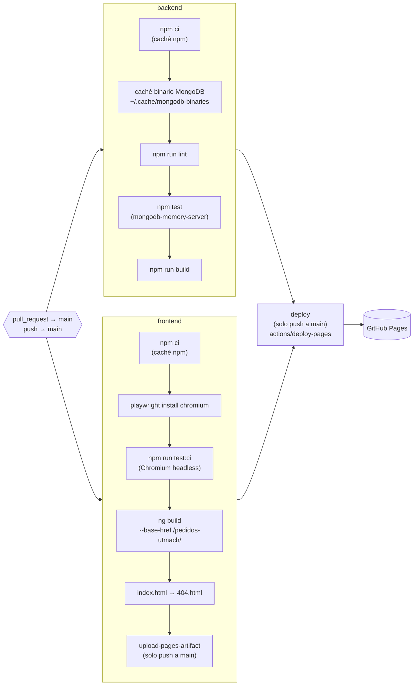

# Despliegue

PedidosUTMACH se publica así:

| Pieza | Dónde se ejecuta |
| --- | --- |
| Frontend (Angular) | GitHub Pages: <https://erick1202.github.io/pedidos-utmach/>, publicado por el CI en cada `push` a `main`. |
| Backend (Express) | La PC de la demo, en `http://localhost:3000/api`. |
| Base de datos | MongoDB local, base `pedidos_utmach` (ya existe). |

> ⚠️ La app publicada **no funciona sola**: llama a `http://localhost:3000/api`, así que en el equipo que la abre deben estar corriendo MongoDB y el backend (`npm run dev:backend`).

## 1. Demo local en Windows

Todos los comandos se ejecutan en PowerShell desde la raíz del repositorio.

### 1.1 Verificar el servicio de MongoDB

```powershell
Get-Service -Name "MongoDB"
```

Si `Status` no es `Running`:

```powershell
Start-Service -Name "MongoDB"
```

> `Start-Service` puede pedir una terminal como administrador. Otra opción: `services.msc` → **MongoDB Server** → **Iniciar**.

### 1.2 Confirmar la base `pedidos_utmach`

En Studio 3T (conexión **MongoDB Local-Tienda** → **Refresh All**) o con `mongosh`:

```powershell
mongosh "mongodb://127.0.0.1:27017/pedidos_utmach" --quiet --eval "db.getCollectionNames().sort()"
```

Debe listar `categorias`, `pedidos`, `productos` y `usuarios`. **No** ejecutes `database/pedidos_utmach.js` si la base ya existe: empieza con `dropDatabase()`.

### 1.3 Configurar y levantar el backend

```powershell
if (-not (Test-Path backend/.env)) { Copy-Item backend/.env.example backend/.env }
npm run dev:backend
```

Al arrancar imprime `ping OK`, los conteos de las cuatro colecciones y `escuchando en http://localhost:3000/api`. Comprueba la API en otra terminal:

```powershell
Invoke-RestMethod http://localhost:3000/api/salud
```

`CORS_ORIGINS` (en `backend/.env`) define qué páginas pueden llamar a la API. Por defecto acepta `http://localhost:4200` y `https://erick1202.github.io`; si lo cambias, reinicia el backend.

### 1.4 Abrir el frontend

Hay dos opciones, ambas con el backend del paso anterior encendido:

- **App publicada:** abre <https://erick1202.github.io/pedidos-utmach/>. Si Chrome o Edge preguntan si el sitio puede **acceder a dispositivos de tu red local**, elige **Permitir**: es la llamada a `localhost:3000`.
- **Frontend local:**

  ```powershell
  npm run dev:frontend
  ```

  y abre <http://localhost:4200>.

Inicia sesión con los usuarios de prueba del [README](../README.md#usuarios-de-prueba).

### 1.5 Problemas frecuentes

| Síntoma | Causa y solución |
| --- | --- |
| La app publicada muestra errores de conexión | El backend no está encendido o el navegador bloqueó el acceso a la red local. Revisa la terminal de `npm run dev:backend` y el permiso del sitio. |
| Error de CORS en la consola | El origen no está en `CORS_ORIGINS`. El origen de Pages es `https://erick1202.github.io`, sin `/pedidos-utmach`. |
| `ECONNREFUSED ::1:27017` | La URI usa `localhost`; usa `127.0.0.1`. |
| Al recargar una ruta de Pages aparece un 404 de GitHub | Falta `404.html` en el artefacto: revisa el paso «Copiar index.html a 404.html» del CI. |

## 2. Cómo funciona el pipeline

El workflow [`.github/workflows/ci.yml`](../.github/workflows/ci.yml) se ejecuta en cada Pull Request hacia `main` y en cada `push` a `main`. Una ejecución nueva de la misma rama cancela la anterior (`concurrency`).



| Job | Qué hace | Cuándo |
| --- | --- | --- |
| `backend` | `npm ci`, lint sin advertencias, Vitest con MongoDB en memoria y `tsc`. Cachea el binario de MongoDB (~780 MB) con una llave basada en `backend/package-lock.json`. | PR y push |
| `frontend` | `npm ci`, pruebas en Chromium headless (`@vitest/browser-playwright`), build de producción con `environment.prod.ts`, `404.html` y artefacto de Pages. | PR y push (artefacto solo en push) |
| `deploy` | Publica el artefacto en el entorno `github-pages` con permisos `pages: write` e `id-token: write`. | Solo push a `main`, tras `backend` y `frontend` |

### Ejecutar los mismos comandos en local

```powershell
# Job backend
cd backend; npm ci; npm run lint; npm test; npm run build; cd ..

# Job frontend (la primera vez: npx playwright install chromium)
cd frontend; npm ci; npm run test:ci; npx ng build --base-href /pedidos-utmach/
Copy-Item dist/pedidos-utmach/browser/index.html dist/pedidos-utmach/browser/404.html; cd ..
```

> En Git Bash usa `MSYS_NO_PATHCONV=1 npx ng build --base-href /pedidos-utmach/`: si no, convierte `/pedidos-utmach/` en una ruta de Windows.

### Configuración única en GitHub

1. **Settings → Pages → Build and deployment → Source: GitHub Actions.**
2. **Settings → Environments → `github-pages`**: permite despliegues desde `main` (GitHub lo crea en el primer despliegue).
3. **Settings → Branches → regla para `main`** (o un *ruleset*): exigir Pull Request, exigir los status checks `backend` y `frontend` y que la rama esté actualizada. `deploy` no se marca como obligatorio porque en los PR se omite.

## 3. Opción futura: base en MongoDB Atlas y backend en la nube

Para que la app publicada funcione sin la PC de la demo:

### 3.1 Migrar la base a Atlas

1. Crea un clúster gratuito **M0** en MongoDB Atlas, un usuario de base de datos y agrega tu IP en **Network Access**.
2. Exporta la base local (solo lectura sobre `pedidos_utmach`):

   ```powershell
   mongodump --uri "mongodb://127.0.0.1:27017/pedidos_utmach" --out respaldo
   ```

3. Restaura en Atlas (conserva validadores e índices, que viajan en los metadatos del volcado):

   ```powershell
   mongorestore --uri "mongodb+srv://<usuario>:<clave>@<cluster>.mongodb.net" --nsInclude "pedidos_utmach.*" respaldo
   ```

4. Verifica los conteos en Atlas (Data Explorer o `mongosh`). No subas la carpeta `respaldo/` al repositorio.

### 3.2 Desplegar el backend

En un servicio como Render, Railway o Fly.io:

| Opción | Valor |
| --- | --- |
| Directorio raíz | `backend` |
| Build | `npm ci && npm run build` |
| Inicio | `npm start` |
| Variables | `MONGODB_URI` (cadena `mongodb+srv://…/pedidos_utmach`), `JWT_SECRET` (largo y aleatorio), `CORS_ORIGINS=https://erick1202.github.io`. `PORT` suele asignarlo el servicio. |

En Atlas, permite el acceso desde las IP del servicio.

### 3.3 Apuntar el frontend al backend en la nube

Cambia `apiUrl` en `frontend/src/environments/environment.prod.ts` a la URL HTTPS del servicio (por ejemplo `https://pedidos-utmach-api.onrender.com/api`) y fusiona el cambio en `main`: el CI publica la nueva versión en Pages. Ninguna otra pieza cambia, porque la aplicación solo depende de `MONGODB_URI` (Artículo VI.8 de la constitución).
