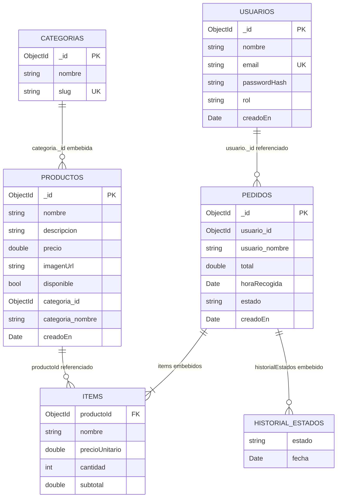

# Modelo de datos — PedidosUTMACH

**Base de datos:** `pedidos_utmach` (MongoDB local `mongodb://127.0.0.1:27017`)
**Fuente de verdad:** [`database/pedidos_utmach.js`](../database/pedidos_utmach.js)
**Consultas de referencia:** [`database/consultas_pedidos_utmach.js`](../database/consultas_pedidos_utmach.js)
**Última revisión:** 2026-10-29

## 1. Contexto

La base ya está creada y poblada. El backend **no** la crea, no la borra y no modifica sus colecciones, validadores ni índices: se conecta a ella y respeta exactamente los nombres y tipos que define el script. Si se necesita reconstruirla (por ejemplo, en otra máquina), se ejecuta el script completo en Studio 3T → IntelliShell; ese script sí elimina y recrea **solo** `pedidos_utmach`.

La base tiene cuatro colecciones: `usuarios`, `categorias`, `productos` y `pedidos`. Es un modelo documental con decisiones deliberadas de embebido y referencia:

- **Embebido:** los ítems del pedido (`items`), el historial de estados y el resumen del usuario dentro del pedido.
- **Desnormalizado:** la categoría dentro del producto (`categoria: { _id, nombre }`).
- **Referenciado:** el usuario en el pedido (`usuario._id`) y el producto en cada ítem (`productoId`), ambos como `ObjectId`.

## 2. Convenciones

| Aspecto | Regla |
| --- | --- |
| Identificadores | `ObjectId` de BSON en `_id`, `usuario._id`, `items.productoId` y `categoria._id`. Nunca cadenas. |
| Fechas | `Date` de BSON, almacenadas en UTC. |
| Zona horaria de negocio | `America/Guayaquil` (UTC-5). Se usa para mostrar horas, validar el rango 07:00–16:00 y agrupar reportes por día/hora. |
| Dinero | Número (`double`, `int` o `decimal`); la aplicación redondea a dos decimales con `Math.round(x * 100) / 100`. |
| Correos | Minúsculas; el índice `ux_email` es único. |
| Contraseñas | Hash `bcrypt` con prefijo `$2b$10` (coste 10). Nunca se almacena la contraseña original. |
| Estados | `recibido` → `preparando` → `listo` → `entregado`. |

## 3. Diagrama del modelo



> En el diagrama, `ITEMS` e `HISTORIAL_ESTADOS` no son colecciones: son subdocumentos embebidos dentro de `pedidos`. La categoría aparece aplanada (`categoria_id`, `categoria_nombre`) para representar el objeto `categoria: { _id, nombre }` embebido en `productos`.

## 4. Colecciones

### 4.1 `usuarios`

| Campo | Tipo BSON | Obligatorio | Reglas |
| --- | --- | --- | --- |
| `_id` | ObjectId | Sí (implícito) | Generado por la aplicación o por MongoDB. |
| `nombre` | string | Sí | Mínimo 3 caracteres. |
| `email` | string | Sí | Patrón `^[^@\s]+@[^@\s]+\.[a-z]{2,}$`; único por `ux_email`; se guarda en minúsculas. |
| `passwordHash` | string | Sí | Hash bcrypt (`$2b$10$...`). |
| `rol` | string | Sí | Enum: `estudiante`, `admin`. |
| `creadoEn` | date | Sí | Fecha de registro. |

### 4.2 `categorias`

| Campo | Tipo BSON | Obligatorio | Reglas |
| --- | --- | --- | --- |
| `_id` | ObjectId | Sí | — |
| `nombre` | string | Sí | Mínimo 3 caracteres. |
| `slug` | string | Sí | Patrón `^[a-z0-9-]+$`; único por `ux_slug`. |

### 4.3 `productos`

| Campo | Tipo BSON | Obligatorio | Reglas |
| --- | --- | --- | --- |
| `_id` | ObjectId | Sí | — |
| `nombre` | string | Sí | Mínimo 3 caracteres. |
| `descripcion` | string | No | Texto libre; participa en el índice de texto. |
| `precio` | double / int / decimal | Sí | Mínimo `0.01` (mayor que cero). |
| `imagenUrl` | string | No | URL externa (Unsplash en los datos de ejemplo). |
| `disponible` | bool | Sí | `true` si aparece en el menú del estudiante. |
| `categoria` | object | Sí | Documento embebido con `_id` (ObjectId) y `nombre` (string). |
| `creadoEn` | date | Sí | — |

### 4.4 `pedidos`

| Campo | Tipo BSON | Obligatorio | Reglas |
| --- | --- | --- | --- |
| `_id` | ObjectId | Sí | — |
| `usuario` | object | Sí | `{ _id: ObjectId, nombre: string }`; resumen embebido del estudiante. |
| `items` | array | Sí | Mínimo 1 elemento. Cada ítem se describe abajo. |
| `total` | double / int / decimal | Sí | Mínimo `0.01`. |
| `horaRecogida` | date | Sí | Debe ser futura y estar entre 07:00 y 16:00 de Ecuador (regla de aplicación). |
| `estado` | string | Sí | Enum: `recibido`, `preparando`, `listo`, `entregado`. |
| `historialEstados` | array | Sí | Cada entrada `{ estado, fecha: Date }`; crece con `$push` al avanzar. El validador no exige mínimo, la aplicación siempre inserta el estado inicial. |
| `creadoEn` | date | Sí | Momento del pedido. |

Cada elemento de `items`:

| Campo | Tipo BSON | Obligatorio | Reglas |
| --- | --- | --- | --- |
| `productoId` | ObjectId | Sí | Referencia al producto original. |
| `nombre` | string | Sí | Snapshot del nombre al comprar. |
| `precioUnitario` | double / int / decimal | Sí | Mínimo `0.01`; snapshot del precio. |
| `cantidad` | int / long / double | Sí | Entero entre 1 y 20 (`multipleOf: 1`). |
| `subtotal` | double / int / decimal | Sí | Mínimo `0.01`; `precioUnitario × cantidad` redondeado. |

## 5. Validación `$jsonSchema`

Las cuatro colecciones usan `validationLevel: "strict"` y `validationAction: "error"`. Un documento inválido produce el error **121** (`Document failed validation`), que la API traduce a `400`. Las reglas más relevantes:

- `usuarios.rol` y `pedidos.estado` son enums cerrados.
- `pedidos.items` exige mínimo un elemento y limita `cantidad` a 20.
- `productos.precio` y `pedidos.total` exigen mínimo `0.01`.
- `categoria` y `usuario` deben ser objetos con `_id` de tipo ObjectId.
- `creadoEn`, `horaRecogida` y `historialEstados[].fecha` deben ser `date`.
- El correo debe cumplir el patrón y ser único por índice.

Para consultar el validador desde Studio 3T:

```javascript
db.getCollectionInfos({ name: "pedidos" })[0].options.validator;
```

## 6. Índices

| Colección | Nombre | Definición | Para qué |
| --- | --- | --- | --- |
| `usuarios` | `ux_email` | `{ email: 1 }`, único | Login, registro sin duplicados. |
| `categorias` | `ux_slug` | `{ slug: 1 }`, único | Identificar categorías por slug. |
| `productos` | `ix_categoria_disponible` | `{ "categoria._id": 1, disponible: 1 }` | Menú por categoría mostrando solo disponibles. |
| `productos` | `tx_busqueda` | `{ nombre: "text", descripcion: "text" }`, `default_language: "spanish"`, pesos `nombre: 3`, `descripcion: 1` | Buscador `?q=` con `$text`. |
| `pedidos` | `ix_usuario_fecha` | `{ "usuario._id": 1, creadoEn: -1 }` | «Mis pedidos» ordenados por fecha descendente. |
| `pedidos` | `ix_estado_hora` | `{ estado: 1, horaRecogida: 1 }` | Pedidos activos del día ordenados por hora de recogida. |

Los planes de ejecución (`explain("executionStats")`) esperados están documentados en `database/consultas_pedidos_utmach.js` y se ampliarán en `docs/consultas-mongodb.md`.

## 7. Por qué se embeben los ítems del pedido

`items` se guarda dentro de `pedidos` porque:

1. **Se leen siempre juntos.** Un pedido no tiene sentido sin sus líneas: la pantalla «Mis pedidos», el tablero del admin y los reportes necesitan el pedido completo. Con embebido, una sola lectura devuelve todo.
2. **El tamaño es acotado.** Cada pedido tiene pocas líneas (el validador permite mínimo 1 y cada línea máximo 20 unidades; el caso de uso real es de 1 a 5 productos). No hay riesgo de documentos gigantes ni del límite de 16 MB.
3. **Atomicidad.** El pedido se crea en una sola inserción: o existe con todos sus ítems o no existe. No se requieren transacciones ni compensaciones entre colecciones.
4. **Snapshot histórico.** `nombre`, `precioUnitario` y `subtotal` se copian al momento de la compra. Si mañana el admin cambia el precio o el nombre del producto, los pedidos anteriores conservan lo que realmente se cobró. Esto es imposible de garantizar si solo se guarda una referencia al producto.
5. **Consultas de reportes.** Aunque los ítems estén embebidos, se pueden analizar con `$unwind` y `$group` (productos más vendidos), sin necesidad de una colección de líneas.

La contrapartida es que actualizar un ítem de forma aislada no es natural, pero el negocio no lo necesita: una línea de pedido no se edita después de confirmar.

### Historial de estados

Se embebe por la misma lógica: siempre se muestra con el pedido, tiene como máximo cuatro entradas (una por estado) y se actualiza con `$push` en la misma operación atómica que cambia `estado`.

## 8. Por qué la categoría se desnormaliza en el producto

`productos.categoria` guarda `{ _id, nombre }` en lugar de solo el `_id`:

1. **El menú se lee por categoría.** La pantalla principal filtra por categoría y muestra su nombre; con el embebido se evita un `$lookup` en la ruta más caliente de la aplicación.
2. **Cambia muy poco.** El nombre de una categoría es estable. El coste de mantener la copia es un `updateMany` cuando el admin la renombra, no una escritura por cada lectura.
3. **Cardinalidad baja.** Cuatro categorías y doce productos: la duplicación ocupa unos pocos bytes y no genera anomalías prácticas.
4. **El `_id` sigue siendo la referencia canónica.** La copia del nombre es una optimización de lectura; el vínculo real es `categoria._id`.

Regla de aplicación asociada: al cambiar el nombre de una categoría se ejecuta `db.productos.updateMany({ "categoria._id": id }, { $set: { "categoria.nombre": nuevoNombre } })` para que las copias no queden obsoletas.

## 9. Por qué los usuarios y los productos se referencian

- **Usuarios:** un estudiante existe independientemente de sus pedidos, se autentica y puede tener muchos pedidos a lo largo del tiempo. Guardar el usuario completo en cada pedido duplicaría credenciales y datos personales, y obligaría a actualizar decenas de documentos si cambia el nombre. Se referencia `usuario._id` y se copia solo `nombre` para mostrar el pedido sin una lectura adicional. El `_id` sigue siendo la fuente de verdad.
- **Productos:** un producto se reutiliza en muchos pedidos y su ciclo de vida es independiente. Referenciarlo evita duplicar la ficha completa y permite que el admin lo edite o lo marque como no disponible sin reescribir el historial. El ítem guarda un **snapshot** (`nombre`, `precioUnitario`) porque el pedido debe conservar el precio cobrado; el `productoId` permite agrupar ventas y hacer `$lookup` para reportes por categoría.

MongoDB no impone integridad referencial. Por eso el backend, al crear un pedido, valida que cada `productoId` exista y esté disponible y toma el precio desde la base; nunca confía en el precio del cliente.

## 10. Equivalencia relacional

El mismo dominio en un motor relacional requeriría **seis tablas** y varios `JOIN`:

| Documento MongoDB | Tabla relacional equivalente | Claves |
| --- | --- | --- |
| `usuarios` | `usuarios` | `id` PK; `email` UNIQUE. |
| `categorias` | `categorias` | `id` PK; `slug` UNIQUE. |
| `productos` (con categoría embebida) | `productos` + `categorias` | `productos.categoria_id` FK → `categorias.id`. |
| `pedidos` (con usuario embebido) | `pedidos` + `usuarios` | `pedidos.usuario_id` FK → `usuarios.id`. |
| `pedidos.items` | `pedido_items` | `pedido_id` FK → `pedidos.id`; `producto_id` FK → `productos.id`; columnas snapshot `nombre`, `precio_unitario`, `cantidad`, `subtotal`. |
| `pedidos.historialEstados` | `pedido_historial` | `pedido_id` FK → `pedidos.id`; `estado`, `fecha`. |

Comparación:

| Aspecto | MongoDB (`pedidos_utmach`) | Modelo relacional |
| --- | --- | --- |
| Leer un pedido completo | 1 lectura de `pedidos` | 1 fila de `pedidos` + N de `pedido_items` + N de `pedido_historial` (o `JOIN` + agregación). |
| Menú por categoría | 1 consulta a `productos` con `categoria._id` y `disponible` | `JOIN productos × categorias` con `WHERE c.id = ? AND p.disponible = true`. |
| Mostrar el nombre del estudiante | Ya está en `pedidos.usuario.nombre` | `JOIN pedidos × usuarios`. |
| Renombrar una categoría | `updateMany` sobre la copia embebida | `UPDATE categorias SET nombre = ?`; los `JOIN` leen el valor nuevo automáticamente. |
| Integridad referencial | La garantiza la aplicación (validar producto y usuario) | `FOREIGN KEY` + restricciones del motor. |
| Snapshot de precio | Copia natural en el subdocumento | Columnas `precio_unitario` y `nombre` en `pedido_items` (también necesarias). |
| Reporte top 5 | `$unwind` + `$group` + `$sort` + `$limit` | `JOIN pedido_items` + `GROUP BY` + `ORDER BY` + `LIMIT`. |
| Escritura del pedido | 1 `insertOne` atómico | Transacción: `INSERT pedidos`, `INSERT pedido_items`, `INSERT pedido_historial`. |

Ejemplos de `JOIN` que el modelo documental evita en las lecturas principales:

```sql
-- Menú por categoría
SELECT p.nombre, p.descripcion, p.precio, p.imagen_url, c.nombre AS categoria
FROM productos p
JOIN categorias c ON c.id = p.categoria_id
WHERE c.id = ? AND p.disponible = TRUE
ORDER BY p.nombre;

-- Pedido completo de un estudiante
SELECT p.id, p.total, p.hora_recogida, p.estado,
       u.nombre AS estudiante,
       i.nombre AS producto, i.cantidad, i.precio_unitario, i.subtotal,
       h.estado AS estado_historial, h.fecha
FROM pedidos p
JOIN usuarios u ON u.id = p.usuario_id
JOIN pedido_items i ON i.pedido_id = p.id
JOIN pedido_historial h ON h.pedido_id = p.id
WHERE p.usuario_id = ?
ORDER BY p.creado_en DESC;

-- Productos más vendidos
SELECT i.nombre, SUM(i.cantidad) AS unidades, SUM(i.subtotal) AS ingresos
FROM pedido_items i
GROUP BY i.nombre
ORDER BY unidades DESC
LIMIT 5;

-- Ventas por categoría
SELECT c.nombre AS categoria, SUM(i.cantidad) AS unidades, SUM(i.subtotal) AS ingresos
FROM pedido_items i
JOIN productos pr ON pr.id = i.producto_id
JOIN categorias c ON c.id = pr.categoria_id
GROUP BY c.nombre
ORDER BY ingresos DESC;
```

## 11. Reglas de integridad que aplica el backend

1. Convertir todo id con `new ObjectId(valor)` y validar antes con `ObjectId.isValid`; si no, responder `400`.
2. Construir fechas con `new Date(...)`, nunca guardar cadenas.
3. Redondear subtotales y total a dos decimales.
4. Al registrar: `rol: "estudiante"`, `creadoEn: new Date()`, correo en minúsculas y hash con `bcryptjs`.
5. Al crear un pedido: buscar cada producto por `_id`, verificar existencia y `disponible: true`, tomar `precio` de la base, calcular `subtotal` y `total`, y armar `usuario: { _id, nombre }` desde el token/BD.
6. Validar la hora de recogida en `America/Guayaquil`: posterior a ahora y entre 07:00 y 16:00.
7. Cambiar de estado solo al siguiente permitido, con `updateOne({ _id, estado: actual }, { $set, $push })`; si `matchedCount === 0`, responder `409`.
8. Al renombrar una categoría, actualizar la copia en `productos` con `updateMany`.
9. Traducir el error 121 a `400` y el 11000 de `email` a `409` con «El correo ya está registrado».

## 12. Datos de ejemplo existentes

| Colección | Documentos | Detalle |
| --- | --- | --- |
| `usuarios` | 6 | 1 admin y 5 estudiantes; hashes `$2b$10`. |
| `categorias` | 4 | Desayunos, Almuerzos, Bebidas, Snacks. |
| `productos` | 12 | 11 disponibles; Tigrillo marcado como no disponible. |
| `pedidos` | 40 | Del 14 al 27 de octubre de 2026: 38 `entregado`, 1 `recibido`, 1 `preparando`. |

Credenciales de prueba:

| Rol | Correo | Contraseña |
| --- | --- | --- |
| Admin | `admin@utmachala.edu.ec` | `Admin123*` |
| Estudiante | `ana.torres@utmachala.edu.ec` | `Estudiante123*` |
| Estudiante | `luis.ramirez@utmachala.edu.ec` | `Estudiante123*` |
| Estudiante | `maria.castillo@utmachala.edu.ec` | `Estudiante123*` |
| Estudiante | `carlos.pineda@utmachala.edu.ec` | `Estudiante123*` |
| Estudiante | `sofia.herrera@utmachala.edu.ec` | `Estudiante123*` |

## 13. Cómo revisar la base

1. Abrir Studio 3T y conectarse a la conexión **MongoDB Local-Tienda** (`mongodb://127.0.0.1:27017`).
2. Clic derecho sobre la conexión → **Refresh All**.
3. Expandir `pedidos_utmach` y revisar las cuatro colecciones.
4. Abrir **IntelliShell** y ejecutar las consultas de [`database/consultas_pedidos_utmach.js`](../database/consultas_pedidos_utmach.js) o las de [`docs/studio3t.md`](studio3t.md) (se completa en la fase 6).

> ⚠️ No ejecutes `database/pedidos_utmach.js` si ya tienes datos que quieres conservar: el script empieza con `db.dropDatabase()`.
